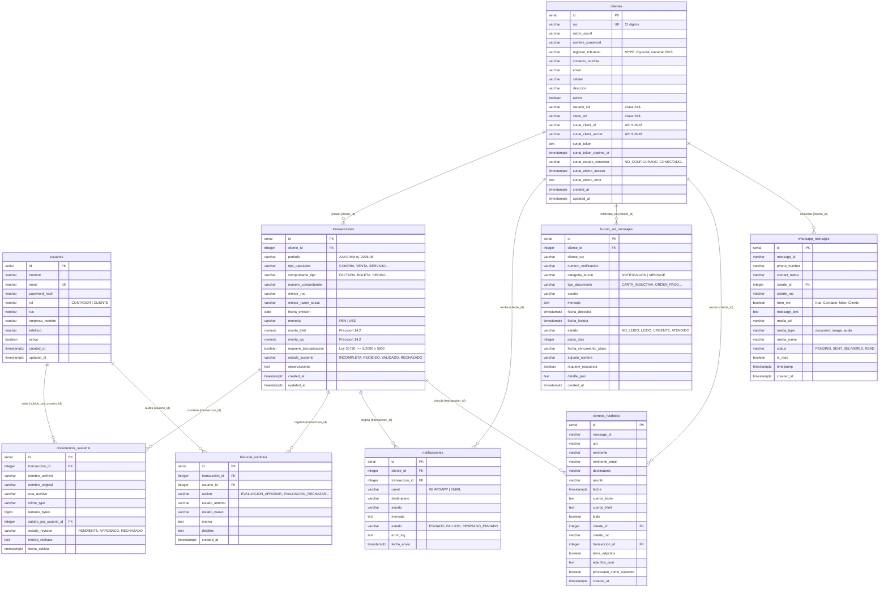

# 📐 Diagrama Entidad-Relación (ER) - ContaTask

**Base de Datos:** `contatask_db`  
**Motor:** PostgreSQL 14+ / 18.x  
**Arquitectura:** Relacional con integridad referencial estricta (`FOREIGN KEY` con `ON DELETE CASCADE / SET NULL`).

---

## 1. Diagrama Entidad-Relación (Mermaid ERD)

---

## 2. Mapa de Relaciones y Cardinalidad

| Tabla Origen (1) | Relación | Tabla Destino (N) | Clave Foránea (`FK`) | Regla de Borrado (`ON DELETE`) | Justificación de Negocio Contable |
| :--- | :---: | :--- | :--- | :---: | :--- |
| **`clientes`** | `1 : N` | `transacciones` | `transacciones.cliente_id` | `CASCADE` | Toda factura o gasto tributario pertenece a un cliente MYPE. |
| **`transacciones`** | `1 : N` | `documentos_sustento` | `documentos_sustento.transaccion_id` | `CASCADE` | Una transacción bancarizada puede tener múltiples vouchers o constancias de depósito. |
| **`transacciones`** | `1 : N` | `historial_auditoria` | `historial_auditoria.transaccion_id` | `CASCADE` | Trazabilidad inalterable de auditoría técnica por cada comprobante evaluado. |
| **`usuarios`** | `1 : N` | `historial_auditoria` | `historial_auditoria.usuario_id` | `SET NULL` | Si un contador es dado de baja, se preserva el registro histórico de la acción realizada. |
| **`usuarios`** | `1 : N` | `documentos_sustento` | `documentos_sustento.subido_por_usuario_id` | `SET NULL` | Identifica qué usuario (contador o cliente) cargó el comprobante. |
| **`clientes`** | `1 : N` | `notificaciones` | `notificaciones.cliente_id` | `CASCADE` | Historial de avisos por WhatsApp y Correo despachados a la MYPE. |
| **`transacciones`** | `1 : N` | `notificaciones` | `notificaciones.transaccion_id` | `SET NULL` | Vincula un recordatorio directamente al comprobante pendiente de sustento. |
| **`clientes`** | `1 : N` | `buzon_sol_mensajes` | `buzon_sol_mensajes.cliente_id` | `CASCADE` | Notificaciones y mensajes del Buzón SOL asignados al contribuyente. |
| **`clientes`** | `1 : N` | `whatsapp_mensajes` | `whatsapp_mensajes.cliente_id` | `SET NULL` | Conversaciones en tiempo real asociadas automáticamente por RUC o Celular. |
| **`clientes`** | `1 : N` | `correos_recibidos` | `correos_recibidos.cliente_id` | `SET NULL` | Bandeja de entrada IMAP vinculada por coincidencia de email o RUC. |
| **`transacciones`** | `1 : N` | `correos_recibidos` | `correos_recibidos.transaccion_id` | `SET NULL` | Permite procesar un correo entrante como sustento bancario formal. |

---

## 3. Módulos y Reglas de Negocio Implementadas en la Base de Datos

### 🏢 Módulo 1: Identidad y MYPEs (`usuarios`, `clientes`)
- Almacenamiento seguro de credenciales con **Bcrypt** (`password_hash`).
- Diferenciación de roles mediante restricción `CHECK (rol IN ('CONTADOR', 'CLIENTE'))`.
- Control de integración con SUNAT: Credenciales de **Clave SOL** (`usuario_sol`, `clave_sol`) y tokens OAuth (`sunat_client_id`, `sunat_token`, `sunat_token_expires_at`).

### 💰 Módulo 2: Cumplimiento y Bancarización (`transacciones`, `documentos_sustento`, `historial_auditoria`)
- **Ley N° 30730 (Bancarización Obligatoria):**
  - Si `monto_total >= 2000.00 PEN` o `monto_total >= 500.00 USD`, la bandera `requiere_bancarizacion` se activa en `TRUE`.
  - Estados del sustento controlados por restricción:
    - `INFORMACION_INCOMPLETA`: Falta comprobante de medio de pago financiero.
    - `SUSTENTO_RECIBIDO`: El cliente subió el voucher en el portal.
    - `VALIDADO`: El contador aprobó la deducibilidad tributaria.
    - `RECHAZADO`: Voucher ilegible, incompleto o no coincidente.

### 📬 Módulo 3: Buzón Electrónico SOL de SUNAT (`buzon_sol_mensajes`)
- Almacenamiento fiel de notificaciones administrativas (`CARTA_INDUCTIVA`, `ESQUELA_CITACION`, `ORDEN_PAGO`) y mensajes informativos (`AVISO_VENCIMIENTO`, `REPORTE_SIRE`).
- Control de cómputo de plazos (`plazo_dias`, `fecha_vencimiento_plazo`) y estado de atención (`NO_LEIDO`, `LEIDO`, `URGENTE`, `ATENDIDO`).

### 💬 Módulo 4: Omnicanalidad en Tiempo Real (`whatsapp_mensajes`, `correos_recibidos`, `notificaciones`)
- **WhatsApp Web Contable:** Registro cronológico de mensajes enviados y recibidos vía Baileys, con disparador automatizado (`auto_vincular_cliente_whatsapp`) que asocia el mensaje a la empresa MYPE según el número celular o RUC remitente.
- **Centro de Correos:** Captura IMAP con soporte para adjuntos en formato JSON y vinculación a sustentos.
- **Auditoría de Notificaciones:** Registro fehaciente de despachos con canal (`WHATSAPP`, `EMAIL`) y bitácora de errores (`error_log`).

---

## 4. Vistas Analíticas Integradas en PostgreSQL

1. **`v_resumen_cumplimiento_mype`**:
   Calcula en tiempo real por cada cliente MYPE:
   - Total de transacciones acumuladas.
   - Cantidad de transacciones pendientes de sustento.
   - Cantidad de sustentos aprobados y rechazados.
   - Monto total sujeto a bancarización (Ley N° 30730).

2. **`v_conversaciones_whatsapp_activas`**:
   Agrupa los mensajes de chat por contacto telefónico:
   - Obtiene el último mensaje y su marca de tiempo.
   - Calcula el contador de mensajes no leídos (`unread_count`).
   - Muestra el nombre comercial o razón social vinculada del cliente.
